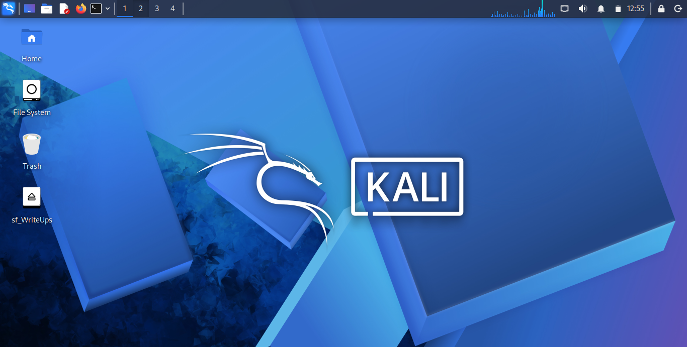
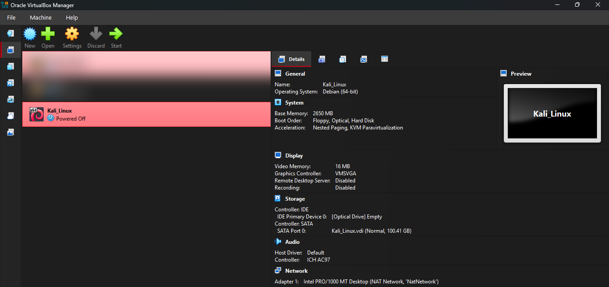
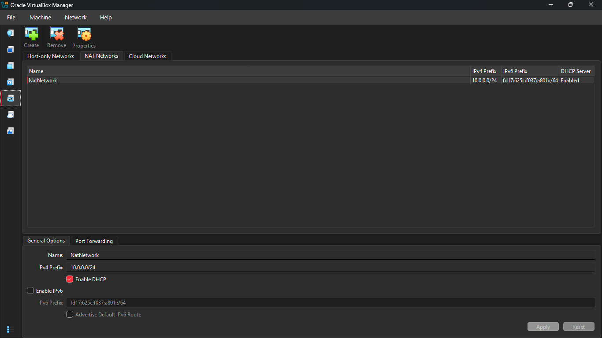
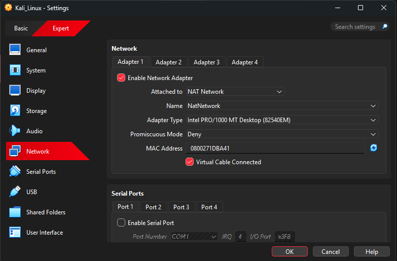
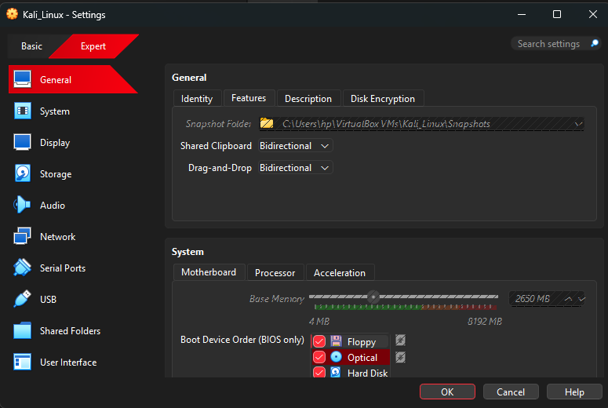
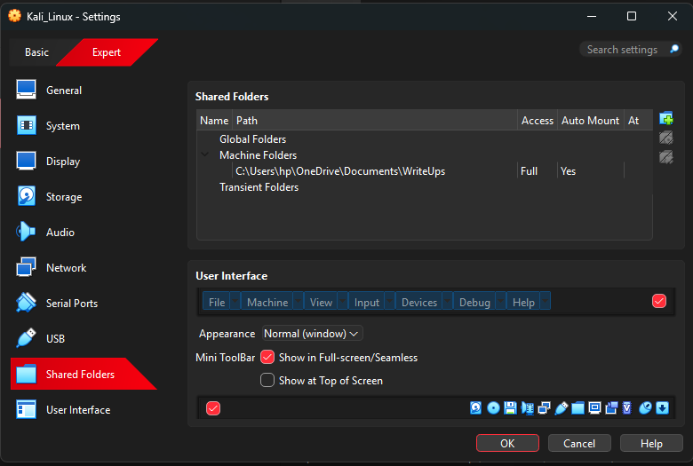
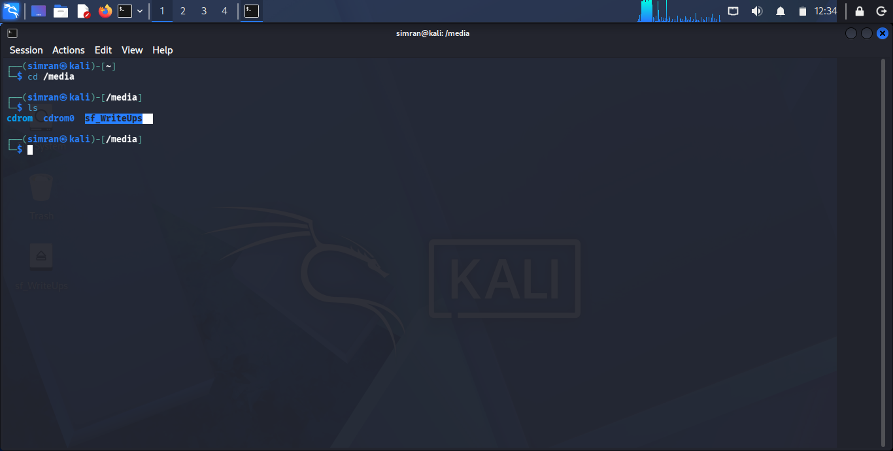
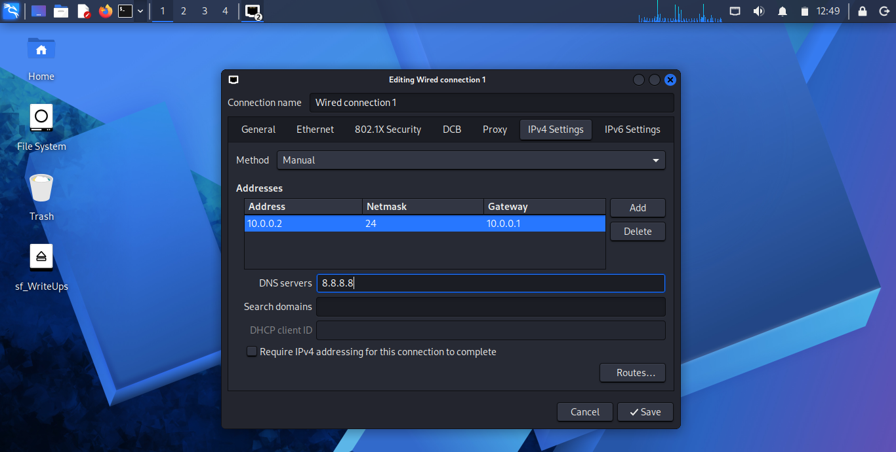
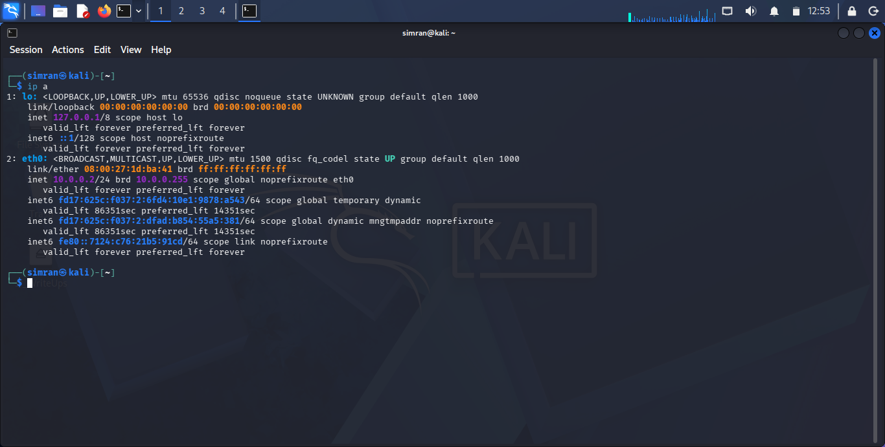
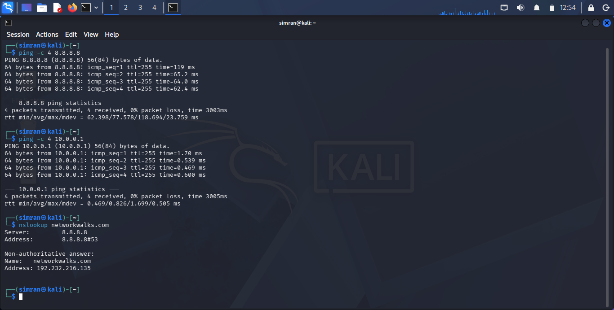

<div align="center">

# 🛡️ Cybersecurity Home Lab: VirtualBox + Kali Linux

**My Week 1 project: a private, isolated lab for practising ethical hacking safely**


</div>

---

## 📌 Project Overview

For Week 1 (WK1-PM1) of the Networkwalks Cybersecurity program I put together a small virtual lab on my own Windows 11 laptop. It uses **VirtualBox** to run **Kali Linux** as my attacker machine, all inside a private network that is separate from my home network.

I already had a Kali VM from earlier practice, so instead of starting from zero I re-used it and reconfigured its networking and host integration to match the lab design required by the task.



---

## 🎯 Objectives

By the end of this project I wanted to have:

- VirtualBox running as the base platform
- Kali Linux working as the attacking machine
- A custom NAT Network on `10.0.0.0/24`
- Kali on the fixed address `10.0.0.2/24`, with working Internet and DNS
- Clipboard sharing and drag & drop between Windows and Kali
- A shared folder between the host and the VM
- Proof (screenshots and commands) that everything works

---

## 🛡️ Purpose of the Lab

This is my safe practice space. Anything I scan, test or break stays inside the virtual network and never touches real systems. Later I plan to add vulnerable target machines to the same network and practise attacking them from Kali.

⚠️ I only test machines that I own or that are part of my own lab.

---

## 🏗️ Lab Architecture

```
Windows 11 laptop (host)
└── VirtualBox 7.2.4
    └── NatNetwork  10.0.0.0/24   gateway 10.0.0.1, DHCP enabled
        └── Kali Linux 2026.3  ->  10.0.0.2 (static)
```



*(Other VMs on my machine are blurred.)*

---

## ⚙️ Lab Configuration

| Component | Setting |
|---|---|
| Host OS | Windows 11 |
| Host CPU / RAM | AMD Ryzen 5 / 8 GB |
| Hypervisor | VirtualBox 7.2.4 |
| Guest OS | Kali Linux 2026.3 |
| Kali memory | 2650 MB |
| Kali disk | ~100 GB virtual disk |
| Network type | NAT Network, name `NatNetwork` |
| Network range | 10.0.0.0/24, DHCP on, IPv6 off |
| Kali address | 10.0.0.2 / 24 (manual) |
| Gateway | 10.0.0.1 |
| DNS | 8.8.8.8 |
| Shared clipboard / drag & drop | Bidirectional |
| Shared folder | Host folder `WriteUps`, auto-mounted, full access |

---

# 🪜 Lab Setup Procedure

## Step 1. VirtualBox

I used VirtualBox 7.2.4 on Windows 11 as the hypervisor for the whole lab.

## Step 2. Create the NAT Network

In **File → Tools → Network → NAT Networks** I set up a network named `NatNetwork` with the prefix `10.0.0.0/24`, DHCP enabled and IPv6 disabled.



I picked a NAT Network (not plain NAT) so that every VM I add later can reach the others on the same private subnet while still getting Internet access through the host.

## Step 3. Attach Kali to the NAT Network

In the Kali VM settings, **Network → Adapter 1** is attached to *NAT Network* → `NatNetwork`.



## Step 4. Clipboard and drag & drop

Under **Settings → General → Features** I set both options to Bidirectional, so I can copy text and move files in both directions between Windows and Kali.



## Step 5. Shared folder

Under **Settings → Shared Folders** I added a host folder with *Auto Mount* on and *Full* access.



After booting Kali, it shows up automatically in `/media` and as a desktop icon:



## Step 6. Set the static IP in Kali

In Kali: **Network icon → Edit Connections → Wired connection 1 → IPv4 Settings** → Method *Manual*:

```
Address: 10.0.0.2
Netmask: 24
Gateway: 10.0.0.1
DNS:     8.8.8.8
```



---

# 🔎 Lab Verification

| Check | Command | What I saw |
|---|---|---|
| Interface address | `ip a` | `eth0` = `10.0.0.2/24` |
| Gateway reachable | `ping -c 4 10.0.0.1` | 4 sent, 4 received, 0% loss |
| Internet reachable | `ping -c 4 8.8.8.8` | 4 sent, 4 received, 0% loss |
| DNS working | `nslookup networkwalks.com` | Name resolved through 8.8.8.8 |





---

# 🐞 Problems Encountered & Solutions

## Problem: my NAT Network used the wrong subnet

My existing NAT Network was on a `192.168.0.0` range. The lab needs `10.0.0.0/24`, so Kali could not get `10.0.0.2` until the network itself was changed.

**How I fixed it**
1. Powered off the VMs using that network.
2. Opened **File → Tools → Network → NAT Networks**, selected `NatNetwork` and changed the IPv4 prefix to `10.0.0.0/24`, keeping DHCP on.
3. Applied the change, set the static address in Kali, then re-ran `ip a`, `ping` and `nslookup` to confirm.

---

# 💡 What I Learned

- A static address only works if the network prefix, gateway and DNS all match, so I now check the **network first, then the VM**.
- A NAT Network is the right choice when several VMs must see each other and also reach the Internet.
- Host integration (clipboard, drag & drop, shared folder) saves a lot of time when moving notes and tools between Windows and Kali.
- Documenting each setting with a screenshot makes a setup easy to repeat and to debug.

---

# 🔐 Security & Ethical Use

This lab is for learning only. I use it on my own machines and never against systems I do not own or have written permission to test.

---

# 🔗 Tools & Resources

- VirtualBox: <https://virtualbox.org/wiki/Downloads>
- Kali Linux: <https://kali.org/get-kali>

---

# 👤 Author

**Simranjit Kaur** — Cybersecurity Intern, Networkwalks (Batch B084D)
GitHub: <https://github.com/Simran-kaur7>
LinkedIn: <https://www.linkedin.com/in/simranjit-kaur-73a696288>

---

## 📌 Project Information

**Program:** Cybersecurity at Networkwalks | **Week:** 01 | **Project:** WK1-PM1 Cybersecurity Lab Setup | **Repository:** GitHub
